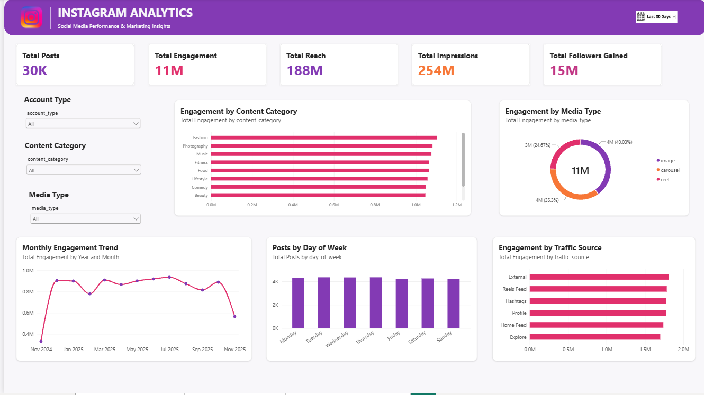
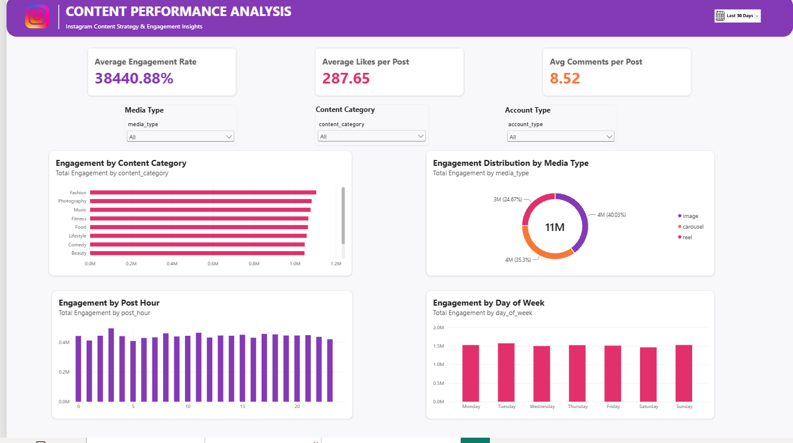
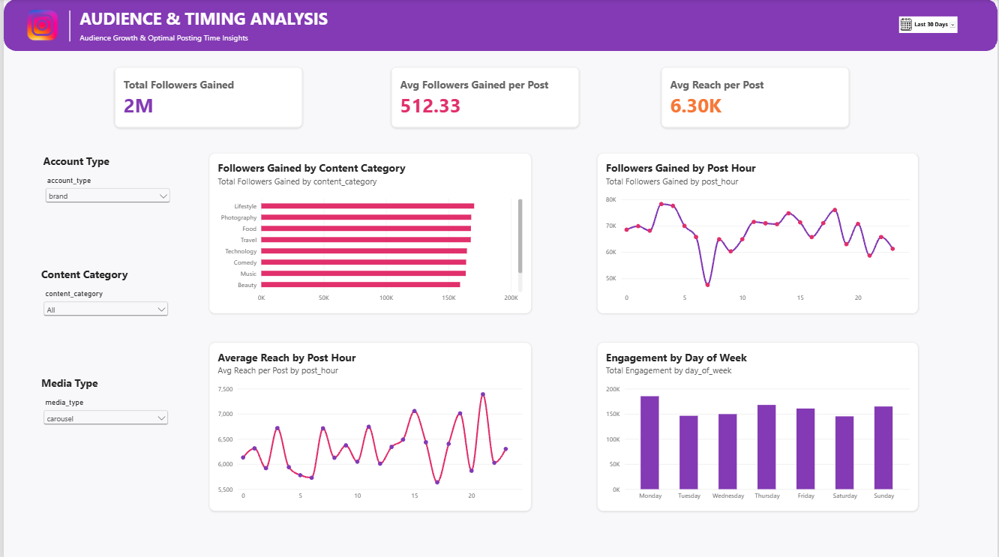

# Instagram Marketing Analytics Dashboard

## Project Overview

This project analyzes Instagram post performance to understand engagement patterns, content performance, audience growth, and posting-time trends using Power BI.

The dashboard provides insights into how different content categories, media types, posting hours, and traffic sources relate to Instagram performance.

## Dataset

- **Source:** Kaggle – Instagram Analytics Dataset
- **Total Records:** 29,999 posts
- **Total Columns:** 23
- **Period:** 2024–2025

The dataset contains information about post types, content categories, likes, comments, shares, saves, reach, impressions, engagement rate, and followers gained.

## Tools Used

- Microsoft Power BI
- Power Query
- DAX
- Microsoft Excel

## Dashboard Pages

### 1. Performance Overview
Provides an overview of Instagram performance through key metrics and visualizations:
- Total Posts
- Total Engagement
- Total Reach
- Total Impressions
- Followers Gained
- Engagement by Content Category
- Engagement by Media Type
- Monthly Engagement Trend
- Posts by Day of Week
- Engagement by Traffic Source

### 2. Content Performance
Analyzes content performance based on engagement metrics:
- Average Engagement Rate
- Average Likes per Post
- Average Comments per Post
- Engagement by Content Category
- Engagement Distribution by Media Type
- Engagement by Post Hour
- Engagement by Day of Week

### 3. Audience & Timing Analysis
Explores audience growth and posting-time performance:
- Total Followers Gained
- Average Followers Gained per Post
- Average Reach per Post
- Followers Gained by Content Category
- Followers Gained by Post Hour
- Average Reach by Post Hour
- Engagement by Day of Week

## Project Files

- `dashboard/Instagram Marketing Analytics Dashboard.pbix` – Power BI dashboard file.
- `dashboard/Instagram Marketing Analytics Dashboard.pdf` – PDF export of the dashboard.
- `screenshots/` – Dashboard page previews.

## Key Objectives

- Evaluate Instagram engagement performance.
- Identify content categories and media types with strong engagement.
- Analyze posting-time and day-of-week patterns.
- Examine follower growth and reach trends.
- Present social media performance data through an interactive dashboard.

## Disclaimer

This project was created for portfolio and learning purposes using a publicly available Kaggle dataset. The analysis reflects the data provided in the dataset and does not represent the performance of a specific real Instagram account.
